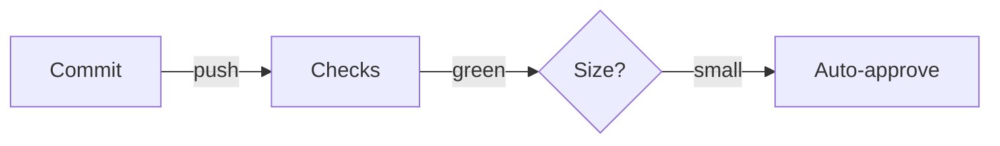
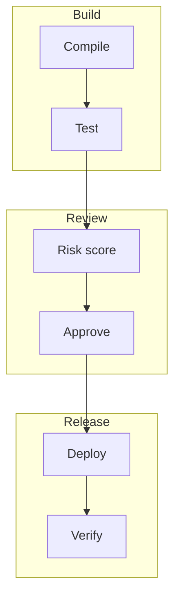

# Deploy approval

## Problem

Every deploy waits for a manual approval, even for one-line changes.

## How it works

## Pipeline path

## Rules

| Change size | Approval | Window |
|---|---|---|
| Small | Automatic | Any time |
| Medium | One reviewer | Work hours |
| Large | Two reviewers | Work hours |

## Situations

1. A hotfix lands on Friday evening.
2. A dependency bump touches many files.
3. A config change has no tests.
4. Two small changes touch the same service.

> [!NOTE]
> Medium and large changes keep the current manual flow.

## Open questions

1. Should small changes skip approval completely?
2. Who owns the risk score thresholds?
3. How long do we keep the audit trail?
