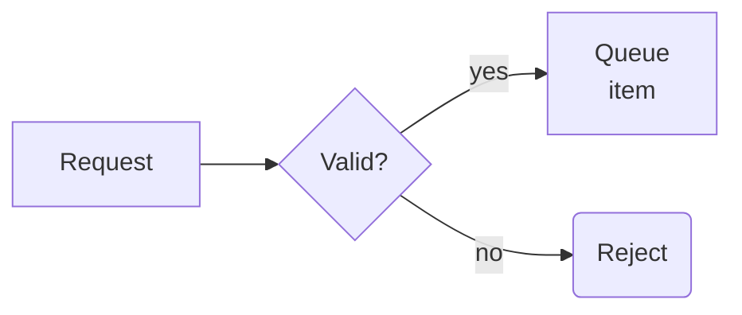

# How the order queue works

A short tour of how a request travels through a small queue-based service.

## Overview

Requests arrive, wait in a queue and are handled one by one by a worker.

## Flow

The diagram above shows the main path.

## Queue

The queue keeps items in arrival order.

## Worker

A worker takes the oldest item and processes it.

## Failures

Rejected items are dropped and a short reason is returned.

## Limits

The queue holds at most one thousand items.
